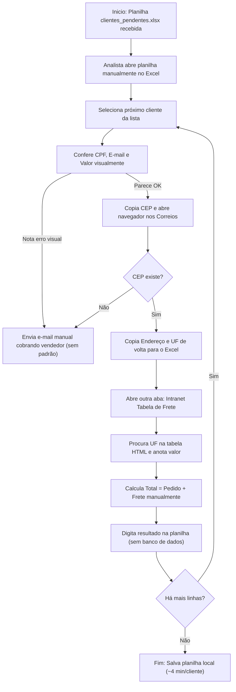
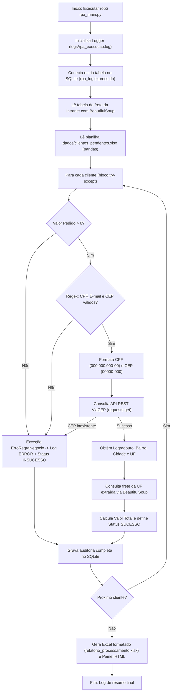
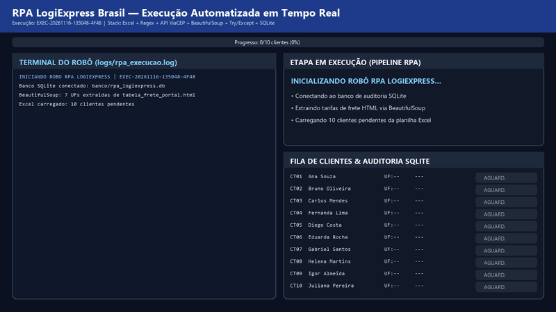

# Apresentação do Projeto RPA — LogiExpress Brasil

> **Tema:** Automação de Validação Cadastral, Enriquecimento de Endereço e Cálculo de Frete Pré-Faturamento  
> **Apresentação em Slides Interativos:** [`apresentacao_slides.html`](apresentacao_slides.html)  
> **Apresentação em PowerPoint:** [`Apresentacao_RPA_LogiExpress.pptx`](Apresentacao_RPA_LogiExpress.pptx)  
> **Vídeo da Execução do Robô:** [`midia/video_execucao_rpa.mp4`](midia/video_execucao_rpa.mp4) | [`midia/video_execucao_rpa.gif`](midia/video_execucao_rpa.gif)

---

## 1. Descrição do Case

### O que a empresa faz?
A **LogiExpress Brasil** é uma operadora logística e transportadora nacional especializada em entregas de e-commerce B2B e B2C. Diariamente, vendedores externos, marketplaces e lojas parceiras enviam novas planilhas contendo pedidos de clientes que precisam ser conferidos e tarifados antes da emissão da Nota Fiscal e da expedição da mercadoria.

### Qual o processo de negócio envolvido?
O processo envolvido é o **Onboarding Cadastral e Cálculo de Frete Pré-Faturamento**, executado diariamente pela área de **Operações Comerciais / Faturamento**. Antes de liberar qualquer pedido no ERP, a equipe precisa garantir que:
1. Os dados cadastrais do cliente (CPF, e-mail e CEP) estão corretos e padronizados;
2. O endereço completo (logradouro, bairro, cidade e UF) é válido na base oficial dos Correios;
3. O valor correto do frete por Estado (UF) foi aplicado conforme a tabela vigente publicada na intranet da empresa;
4. O valor total do pedido (`Valor do Pedido + Frete`) foi calculado e registrado para cobrança.

### Qual é a tarefa repetitiva realizada manualmente?
Hoje, **3 analistas** recebem uma planilha Excel (`clientes_pendentes.xlsx`) com dezenas ou centenas de linhas por dia e executam, **um cliente por vez**, a mesma rotina repetitiva:
- Abrir a planilha no Excel e ler a linha do cliente;
- Conferir visualmente ("no olhômetro") se o CPF tem 11 dígitos, se o e-mail possui `@` e se o valor do pedido é positivo;
- Copiar o CEP da planilha, abrir o navegador, acessar o site dos Correios/ViaCEP e colar o CEP para descobrir rua, bairro, cidade e UF;
- Abrir outra aba do navegador na **Intranet da empresa**, localizar o Estado (UF) na tabela HTML de fretes e anotar o valor da tarifa;
- Voltar ao Excel, formatar manualmente CPF/CEP, digitar o endereço, somar o frete ao valor do pedido e salvar o arquivo final.

Essa rotina mecânica de *"copia daqui, consulta ali, cola acolá"* gera cansaço, fila acumulada de pedidos e erros humanos frequentes.

---

## 2. Justificativa da Automação

### Quanto tempo cada pessoa gasta hoje vs. com o RPA?
- **Cenário Atual (Manual - As-Is):**
  - Cada cadastro completo leva em média **4 minutos** por analista (entre abrir abas, copiar e colar dados, conferir CEP, consultar a tabela da intranet, formatar campos e calcular o total).
  - Para um volume médio de **150 novos pedidos/dia**:  
    $$\text{150 pedidos} \times \text{4 minutos} = \text{600 minutos/dia} = \mathbf{10\text{ horas/dia}}$$
  - Isso consome o expediente integral de praticamente **2 analistas em tempo integral** apenas em digitação e conferência manual, atrasando o faturamento em dias de pico.

- **Cenário Automatizado (RPA - To-Be):**
  - O robô processa um lote de **10 clientes em cerca de 1 a 2 segundos** (média aproximada de 0,1s a 0,2s por registro quando em rede local/contingência, ou alguns segundos no lote completo via API pública).
  - Um lote diário de **150 pedidos** passa a ser executado em **menos de 1 minuto**, liberando **10 horas diárias** da equipe para atividades estratégicas (negociação com clientes, resolução de exceções logísticas reais e acompanhamento de entregas).

### Novos requisitos de negócio adicionados para elevar a qualidade
Além de apenas acelerar o trabalho manual, o RPA permitiu incorporar **regras de qualidade e governança** que não existiam no processo manual:
1. **Padronização Estrita com Expressões Regulares (Regex):** Todos os CPFs saem padronizados no formato `000.000.000-00` e os CEPs no formato `00000-000`, além de validar sintaxe de e-mail e rejeitar sequências numéricas repetidas.
2. **Bloqueio Preventivo de Erros de Negócio:** Pedidos com valor negativo/zero, CPF incompleto, e-mail inválido ou CEP inexistente na base dos Correios são bloqueados automaticamente com status `INSUCESSO` antes de gerar boleto ou Nota Fiscal errada.
3. **Resiliência por Registro (`try-except`):** Um erro no pedido #3 não interrompe a fila; o robô registra o motivo exato do erro e segue imediatamente para o pedido #4.
4. **Trilha de Auditoria em Banco SQLite e Logs:** Cada execução recebe um `id_execucao` único, gravando todos os passos em `logs/rpa_execucao.log` e persistindo cada registro (sucesso e insucesso) no banco `banco/rpa_logiexpress.db`.
5. **Relatório Gerencial Automático:** Gera uma planilha formatada (`relatorio_processamento.xlsx`) com destaque visual (verde/vermelho) e uma aba de `Resumo_Executivo`.

---

## 3. Desenho do Fluxo Atual Manual (As-Is)

No fluxo **As-Is**, todas as integrações e validações dependem exclusivamente de ações humanas repetitivas no Excel e no navegador:



---

## 4. Desenho do Novo Fluxo Automatizado (To-Be)

No fluxo **To-Be**, o robô `rpa_main.py` orquestra leitura, validação Regex, API ViaCEP, raspagem da intranet com BeautifulSoup, tratamento de exceções, banco SQLite, logs e relatórios finais automaticamente:



---

## 5. Exemplos do Código-Fonte Gerado

O robô foi desenvolvido em Python puro e modular no arquivo [`rpa_main.py`](rpa_main.py) para ser simples de entender e manter. Abaixo estão os trechos principais que atendem aos requisitos técnicos:

### A) Expressões Regulares (Validação e Padronização de CPF, E-mail e CEP)
```python
def validar_e_formatar_cpf(cpf_bruto: str) -> str:
    """Valida se o CPF possui 11 dígitos válidos e retorna no padrão 000.000.000-00."""
    digitos = re.sub(r"\D", "", str(cpf_bruto or ""))
    if not re.match(r"^\d{11}$", digitos):
        raise ErroRegraNegocio(
            f"CPF inválido ('{cpf_bruto}'): deve conter exatamente 11 dígitos numéricos."
        )
    if len(set(digitos)) == 1:
        raise ErroRegraNegocio(
            f"CPF inválido ('{cpf_bruto}'): sequência repetida não permitida."
        )
    return re.sub(r"(\d{3})(\d{3})(\d{3})(\d{2})", r"\1.\2.\3-\4", digitos)


def validar_email(email_bruto: str) -> str:
    """Valida o formato do e-mail utilizando Expressão Regular."""
    email_limpo = str(email_bruto or "").strip().lower()
    padrao_email = r"^[\w\.-]+@[\w\.-]+\.\w{2,}$"
    if not re.match(padrao_email, email_limpo):
        raise ErroRegraNegocio(
            f"E-mail inválido ('{email_bruto}'): formato não atende ao padrão usuário@domínio.ext."
        )
    return email_limpo
```

### B) Web Scraping da Intranet com BeautifulSoup
```python
def carregar_tabela_frete_html(caminho_html: Path, logger: logging.Logger) -> dict[str, float]:
    """Lê a tabela HTML de fretes da intranet usando BeautifulSoup4."""
    conteudo = caminho_html.read_text(encoding="utf-8")
    soup = BeautifulSoup(conteudo, "html.parser")
    tabela = soup.find("table", id="tabela-frete")

    tabela_fretes: dict[str, float] = {}
    for linha in tabela.select("tbody tr.linha-uf"):
        uf = linha.get("data-uf", "").strip().upper()
        celula_valor = linha.select_one("td.valor-frete")
        if uf and celula_valor:
            tabela_fretes[uf] = float(celula_valor.text.strip())
    return tabela_fretes
```

### C) Integração com API ViaCEP + Resiliência com `try-except` + SQLite
```python
try:
    valor_pedido = float(valor_pedido_bruto)
    if valor_pedido <= 0:
        raise ErroRegraNegocio(f"Valor do pedido inválido (R$ {valor_pedido:.2f}): deve ser maior que zero.")

    cpf_formatado = validar_e_formatar_cpf(cpf_bruto)
    email_valido = validar_email(email_bruto)
    cep_limpo, cep_formatado = validar_e_formatar_cep(cep_bruto)

    dados_cep = consultar_api_viacep(cep_limpo, logger)
    uf = dados_cep.get("uf", "").strip().upper()
    valor_frete = tabela_fretes.get(uf, tabela_fretes.get("OUTROS", 65.0))
    valor_total = round(valor_pedido + valor_frete, 2)
    registro["status"] = "SUCESSO"
except ErroRegraNegocio as erro_negocio:
    registro["status"] = "INSUCESSO"
    registro["mensagem_detalhe"] = f"Regra de Negócio: {erro_negocio}"
    logger.error("[%s] INSUCESSO (Regra de Negócio): %s", id_cliente, erro_negocio)

salvar_registro_banco(conn, registro)
```

---

## 6. Vídeo da Execução do Robô e Evidências Visuais

O vídeo demonstrando a execução passo a passo do robô (leitura da planilha, validação Regex, chamada da API ViaCEP, consulta à tabela extraída pelo BeautifulSoup, captura dos erros de negócio e gravação no SQLite) foi gerado em:
- **Vídeo MP4 (Alta Definição):** [`midia/video_execucao_rpa.mp4`](midia/video_execucao_rpa.mp4)
- **Animação GIF (Visualização Rápida):** [`midia/video_execucao_rpa.gif`](midia/video_execucao_rpa.gif)



---

## 7. Ganhos para a Empresa

| Dimensão | Antes (As-Is Manual) | Depois (To-Be com RPA) | Ganho Obtido |
|---|---|---|---|
| **Tempo por Cadastro** | ~4 minutos por cliente | Frações de segundo por cliente | **Redução > 99% do tempo** |
| **Capacidade Diária (150 pedidos)** | 10 horas/dia (2 analistas dedicados) | < 1 minuto de execução automática | **Economia de ~200h/mês** |
| **Taxa de Erro de Digitação / Frete** | Sujeito a falhas humanas frequentes | Zero erro de cálculo e máscara | **100% de padronização Regex** |
| **Controle de Regras de Negócio** | Conferência visual sem bloqueio formal | Bloqueio automático de CPF/CEP/Email/Valor inválido | **Prevenção de faturamento errado** |
| **Auditoria e Rastreabilidade** | Planilha sobrescrita sem histórico | Banco SQLite + Log passo a passo | **Compliance completo por execução** |
| **Escalabilidade** | Precisava contratar mais pessoas em picos | Robô absorve picos de volume sem custo extra | **Escalabilidade imediata** |
