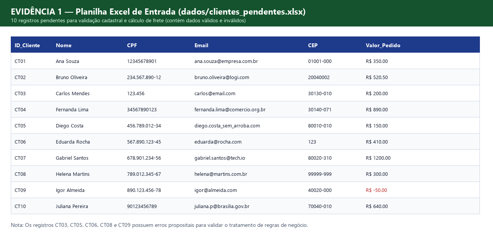
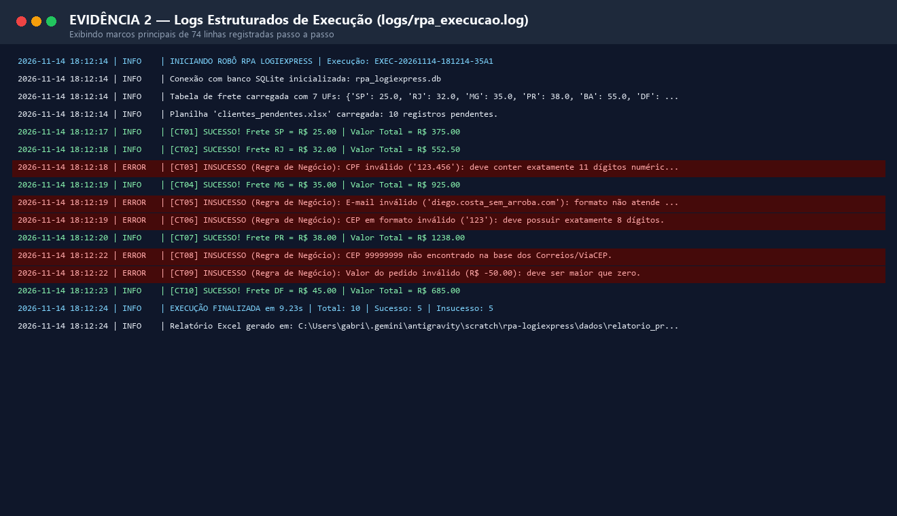
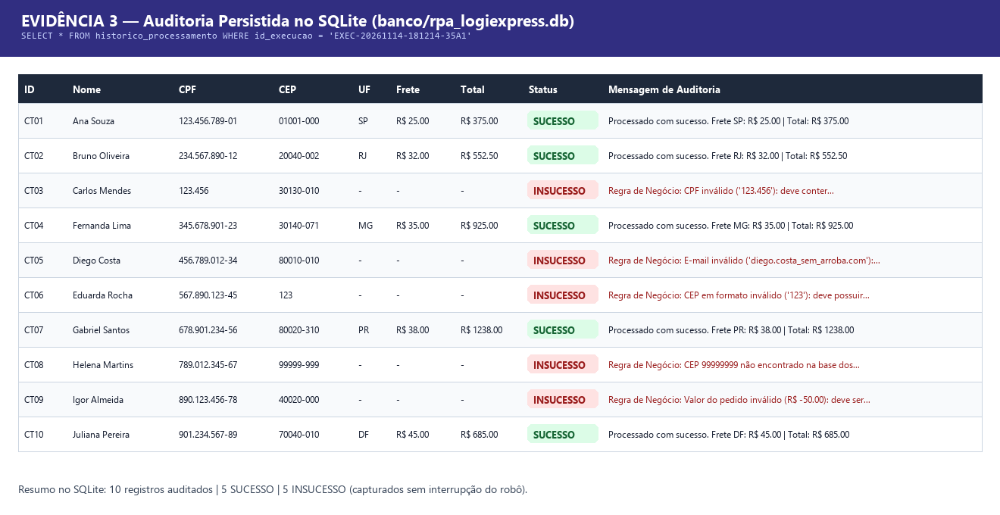
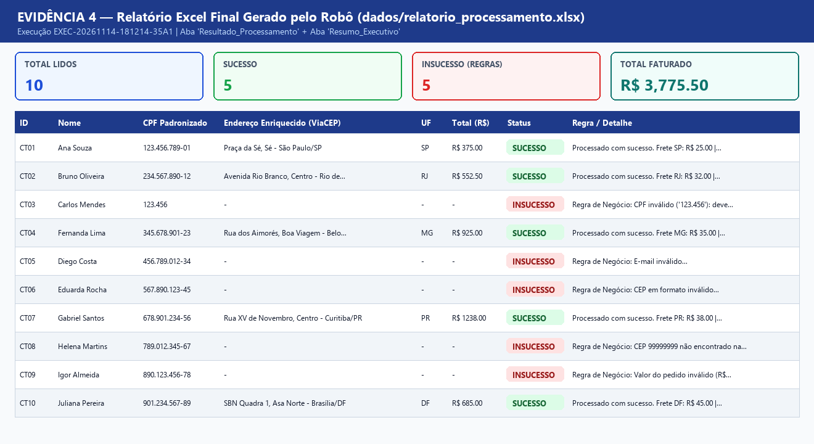

# Caderno de Evidências de Teste — RPA LogiExpress Brasil

> **Identificador da Execução Auditada:** `EXEC-20261114-181214-35A1`  
> **Data/Hora da Execução:** `2026-11-14 18:12:14` a `18:12:24` (Duração total: `9.23s` com chamadas reais à API ViaCEP)  
> **Versão Visual/Imprimível (PDF):** [`evidencias_teste.html`](evidencias_teste.html)  
> **Artefatos de Origem Verificados:**
> - Planilha de Entrada: [`dados/clientes_pendentes.xlsx`](dados/clientes_pendentes.xlsx)
> - Planilha de Saída: [`dados/relatorio_processamento.xlsx`](dados/relatorio_processamento.xlsx)
> - Log de Execução: [`logs/rpa_execucao.log`](logs/rpa_execucao.log)
> - Banco SQLite: [`banco/rpa_logiexpress.db`](banco/rpa_logiexpress.db)
> - Painel HTML: [`portal_intranet/painel_resultado.html`](portal_intranet/painel_resultado.html)

---

## 1. Resumo Executivo da Bateria de Testes

| Métrica | Valor Observado |
|---|---|
| **Total de Cenários Executados** | `10` (`CT01` a `CT10`) |
| **Cenários de Sucesso (Fluxo Completo)** | `5` (`CT01`, `CT02`, `CT04`, `CT07`, `CT10`) |
| **Cenários de Insucesso (Bloqueio por Regra de Negócio)** | `5` (`CT03`, `CT05`, `CT06`, `CT08`, `CT09`) |
| **Falhas Não Tratadas / Travamentos do Robô** | `0` (100% resiliente via `try-except`) |
| **Total Faturado nos Pedidos Aprovados** | `R$ 3.775,50` |

---

## 2. Lista Completa de Cenários de Teste

| ID | Tipo | Cliente | Entrada Testada | Regra de Negócio Validada | Resultado Esperado | Resultado Obtido |
|---|---|---|---|---|---|---|
| **CT01** | Sucesso | Ana Souza | CPF `12345678901`, CEP `01001-000`, Pedido `R$ 350,00` | Padronizar CPF sem máscara + API ViaCEP (SP) + Frete SP (`R$ 25,00`) | `SUCESSO` (`Total R$ 375,00`) | **PASSOU (`SUCESSO`)** |
| **CT02** | Sucesso | Bruno Oliveira | CPF `234.567.890-12`, CEP `20040002`, Pedido `R$ 520,50` | Padronizar CEP sem hífen + API ViaCEP (RJ) + Frete RJ (`R$ 32,00`) | `SUCESSO` (`Total R$ 552,50`) | **PASSOU (`SUCESSO`)** |
| **CT03** | **Insucesso** | Carlos Mendes | CPF `123.456`, CEP `30130-010`, Pedido `R$ 200,00` | Regex `^\d{11}$` rejeita CPF com menos de 11 dígitos | `INSUCESSO` sem travar fila | **PASSOU (`INSUCESSO` capturado)** |
| **CT04** | Sucesso | Fernanda Lima | CPF `34567890123`, CEP `30140-071`, Pedido `R$ 890,00` | Padronizar CPF + API ViaCEP (MG) + Frete MG (`R$ 35,00`) | `SUCESSO` (`Total R$ 925,00`) | **PASSOU (`SUCESSO`)** |
| **CT05** | **Insucesso** | Diego Costa | E-mail `diego.costa_sem_arroba.com`, Pedido `R$ 150,00` | Regex `^[\w\.-]+@[\w\.-]+\.\w{2,}$` rejeita e-mail sem `@` | `INSUCESSO` sem travar fila | **PASSOU (`INSUCESSO` capturado)** |
| **CT06** | **Insucesso** | Eduarda Rocha | CEP `123`, Pedido `R$ 410,00` | Regex `^\d{8}$` rejeita CEP com menos de 8 dígitos | `INSUCESSO` sem travar fila | **PASSOU (`INSUCESSO` capturado)** |
| **CT07** | Sucesso | Gabriel Santos | CPF `678.901.234-56`, CEP `80020-310`, Pedido `R$ 1.200,00` | Regex + API ViaCEP (PR) + Frete PR (`R$ 38,00`) | `SUCESSO` (`Total R$ 1.238,00`) | **PASSOU (`SUCESSO`)** |
| **CT08** | **Insucesso** | Helena Martins | CEP `99999-999`, Pedido `R$ 300,00` | CEP válido no Regex, mas inexistente na base da API ViaCEP | `INSUCESSO` sem travar fila | **PASSOU (`INSUCESSO` capturado)** |
| **CT09** | **Insucesso** | Igor Almeida | Pedido `-50.00`, CEP `40020-000` | Regra financeira: `valor_pedido` deve ser `> 0` | `INSUCESSO` sem travar fila | **PASSOU (`INSUCESSO` capturado)** |
| **CT10** | Sucesso | Juliana Pereira | CPF `90123456789`, CEP `70040-010`, Pedido `R$ 640,00` | Padronizar CPF + API ViaCEP (DF) + Frete DF (`R$ 45,00`) | `SUCESSO` (`Total R$ 685,00`) | **PASSOU (`SUCESSO`)** |

---

## 3. Evidência de Entrada e Carga Inicial

### Massa de Teste (`dados/clientes_pendentes.xlsx`)


### Trecho Inicial do Log (`logs/rpa_execucao.log`)
```text
2026-11-14 18:12:14 | INFO    | INICIANDO ROBÔ RPA LOGIEXPRESS | Execução: EXEC-20261114-181214-35A1
2026-11-14 18:12:14 | INFO    | Conexão com banco SQLite inicializada: rpa_logiexpress.db
2026-11-14 18:12:14 | INFO    | Lendo tabela oficial de frete via BeautifulSoup: tabela_frete_portal.html
2026-11-14 18:12:14 | INFO    | Tabela de frete carregada com 7 UFs: {'SP': 25.0, 'RJ': 32.0, 'MG': 35.0, 'PR': 38.0, 'BA': 55.0, 'DF': 45.0, 'OUTROS': 65.0}
2026-11-14 18:12:14 | INFO    | Planilha 'clientes_pendentes.xlsx' carregada: 10 registros pendentes.
```

---

## 4. Evidências Detalhadas — Cenários de SUCESSO

Nos 5 cenários de sucesso, o robô executou integralmente todas as etapas: validação de valor, padronização via Expressão Regular (`re`), consulta à API pública ViaCEP, obtenção da tarifa de frete raspada via `BeautifulSoup`, cálculo do total e persistência em banco SQLite e Excel.

### CT01 — Ana Souza (Formatação de CPF sem máscara + SP)
- **Entrada:** CPF `12345678901` | CEP `01001-000` | Valor Pedido `R$ 350,00`
- **Saída Enriquecida:** CPF `123.456.789-01` | Endereço `Praça da Sé, Sé - São Paulo/SP` | Frete `R$ 25,00` | Total `R$ 375,00`
- **Evidência em Log:**
```text
2026-11-14 18:12:14 | INFO    | [CT01] Iniciando processamento de 'Ana Souza'...
2026-11-14 18:12:14 | INFO    | [CT01] CPF validado e padronizado via Regex: 123.456.789-01
2026-11-14 18:12:14 | INFO    | [CT01] E-mail validado via Regex: ana.souza@empresa.com.br
2026-11-14 18:12:14 | INFO    | [CT01] CEP validado e formatado via Regex: 01001-000
2026-11-14 18:12:14 | INFO    | [CT01] Consultando API ViaCEP para CEP 01001000...
2026-11-14 18:12:17 | INFO    | [CT01] Endereço obtido da API: Praça da Sé, Sé - São Paulo/SP
2026-11-14 18:12:17 | INFO    | [CT01] SUCESSO! Frete SP = R$ 25.00 | Valor Total = R$ 375.00
```

### CT02 — Bruno Oliveira (Formatação de CEP sem hífen + RJ)
- **Entrada:** CPF `234.567.890-12` | CEP `20040002` | Valor Pedido `R$ 520,50`
- **Saída Enriquecida:** CEP `20040-002` | Endereço `Avenida Rio Branco, Centro - Rio de Janeiro/RJ` | Frete `R$ 32,00` | Total `R$ 552,50`
- **Evidência em Log:**
```text
2026-11-14 18:12:17 | INFO    | [CT02] Iniciando processamento de 'Bruno Oliveira'...
2026-11-14 18:12:17 | INFO    | [CT02] CPF validado e padronizado via Regex: 234.567.890-12
2026-11-14 18:12:17 | INFO    | [CT02] E-mail validado via Regex: bruno.oliveira@logi.com
2026-11-14 18:12:17 | INFO    | [CT02] CEP validado e formatado via Regex: 20040-002
2026-11-14 18:12:17 | INFO    | [CT02] Consultando API ViaCEP para CEP 20040002...
2026-11-14 18:12:18 | INFO    | [CT02] Endereço obtido da API: Avenida Rio Branco, Centro - Rio de Janeiro/RJ
2026-11-14 18:12:18 | INFO    | [CT02] SUCESSO! Frete RJ = R$ 32.00 | Valor Total = R$ 552.50
```

### CT04 — Fernanda Lima (MG), CT07 — Gabriel Santos (PR) e CT10 — Juliana Pereira (DF)
```text
2026-11-14 18:12:19 | INFO    | [CT04] Endereço obtido da API: Rua dos Aimorés, Boa Viagem - Belo Horizonte/MG
2026-11-14 18:12:19 | INFO    | [CT04] SUCESSO! Frete MG = R$ 35.00 | Valor Total = R$ 925.00

2026-11-14 18:12:20 | INFO    | [CT07] Endereço obtido da API: Rua XV de Novembro, Centro - Curitiba/PR
2026-11-14 18:12:20 | INFO    | [CT07] SUCESSO! Frete PR = R$ 38.00 | Valor Total = R$ 1238.00

2026-11-14 18:12:23 | INFO    | [CT10] Endereço obtido da API: SBN Quadra 1, Asa Norte - Brasília/DF
2026-11-14 18:12:23 | INFO    | [CT10] SUCESSO! Frete DF = R$ 45.00 | Valor Total = R$ 685.00
```

---

## 5. Evidências Detalhadas — Cenários de INSUCESSO (Erros de Regra de Negócio)

Nos 5 cenários de insucesso, **o robô NÃO concluiu o processo de faturamento para aquele cliente**, pois uma regra de negócio foi violada. Graças ao bloco `try ... except ErroRegraNegocio`, o RPA interceptou a falha com segurança, registrou o nível `ERROR` no log, gravou o status `INSUCESSO` e o motivo no banco SQLite e na planilha final, e **seguiu normalmente para o próximo registro**.

### CT03 — Carlos Mendes (Erro: CPF Inválido — menos de 11 dígitos)
- **Entrada:** CPF `123.456` | Pedido `R$ 200,00`
- **Ponto de Bloqueio:** Função `validar_e_formatar_cpf()` (Regex `^\d{11}$`)
- **Evidência em Log:**
```text
2026-11-14 18:12:18 | INFO    | [CT03] Iniciando processamento de 'Carlos Mendes'...
2026-11-14 18:12:18 | ERROR   | [CT03] INSUCESSO (Regra de Negócio): CPF inválido ('123.456'): deve conter exatamente 11 dígitos numéricos.
```
- **Comportamento:** Não consultou a API ViaCEP nem calculou frete; gravado no SQLite como `INSUCESSO` e passou imediatamente ao `CT04`.

### CT05 — Diego Costa (Erro: E-mail Inválido — sem `@`)
- **Entrada:** E-mail `diego.costa_sem_arroba.com` | Pedido `R$ 150,00`
- **Ponto de Bloqueio:** Função `validar_email()` (Regex `^[\w\.-]+@[\w\.-]+\.\w{2,}$`)
- **Evidência em Log:**
```text
2026-11-14 18:12:19 | INFO    | [CT05] Iniciando processamento de 'Diego Costa'...
2026-11-14 18:12:19 | INFO    | [CT05] CPF validado e padronizado via Regex: 456.789.012-34
2026-11-14 18:12:19 | ERROR   | [CT05] INSUCESSO (Regra de Negócio): E-mail inválido ('diego.costa_sem_arroba.com'): formato não atende ao padrão usuário@domínio.ext.
```

### CT06 — Eduarda Rocha (Erro: CEP em Formato Inválido)
- **Entrada:** CEP `123` | Pedido `R$ 410,00`
- **Ponto de Bloqueio:** Função `validar_e_formatar_cep()` (Regex `^\d{8}$`)
- **Evidência em Log:**
```text
2026-11-14 18:12:19 | INFO    | [CT06] Iniciando processamento de 'Eduarda Rocha'...
2026-11-14 18:12:19 | INFO    | [CT06] CPF validado e padronizado via Regex: 567.890.123-45
2026-11-14 18:12:19 | INFO    | [CT06] E-mail validado via Regex: eduarda@rocha.com
2026-11-14 18:12:19 | ERROR   | [CT06] INSUCESSO (Regra de Negócio): CEP em formato inválido ('123'): deve possuir exatamente 8 dígitos.
```

### CT08 — Helena Martins (Erro: CEP Inexistente na API ViaCEP)
- **Entrada:** CEP `99999-999` | Pedido `R$ 300,00`
- **Ponto de Bloqueio:** Função `consultar_api_viacep()` — passou pelo Regex (`99999-999` tem 8 dígitos), consultou a API ViaCEP ao vivo e recebeu `{"erro": "true"}`.
- **Evidência em Log:**
```text
2026-11-14 18:12:20 | INFO    | [CT08] Iniciando processamento de 'Helena Martins'...
2026-11-14 18:12:20 | INFO    | [CT08] CPF validado e padronizado via Regex: 789.012.345-67
2026-11-14 18:12:20 | INFO    | [CT08] E-mail validado via Regex: helena@martins.com.br
2026-11-14 18:12:20 | INFO    | [CT08] CEP validado e formatado via Regex: 99999-999
2026-11-14 18:12:20 | INFO    | [CT08] Consultando API ViaCEP para CEP 99999999...
2026-11-14 18:12:22 | ERROR   | [CT08] INSUCESSO (Regra de Negócio): CEP 99999999 não encontrado na base dos Correios/ViaCEP.
```

### CT09 — Igor Almeida (Erro: Valor do Pedido Negativo)
- **Entrada:** Valor Pedido `-50.00` | CEP `40020-000`
- **Ponto de Bloqueio:** Validação financeira inicial (`if valor_pedido <= 0: raise ErroRegraNegocio(...)`)
- **Evidência em Log:**
```text
2026-11-14 18:12:22 | INFO    | [CT09] Iniciando processamento de 'Igor Almeida'...
2026-11-14 18:12:22 | ERROR   | [CT09] INSUCESSO (Regra de Negócio): Valor do pedido inválido (R$ -50.00): deve ser maior que zero.
```

---

## 6. Evidências Consolidadas (Logs, Banco SQLite e Planilha Final)

### Logs Estruturados (`logs/rpa_execucao.log`)


### Registros Auditados no Banco SQLite (`banco/rpa_logiexpress.db`)
Saída real obtida pelo comando `python consultar_banco.py`:
```text
==============================================================================================================
BANCO SQLITE: rpa_logiexpress.db | Última Execução: EXEC-20261114-181214-35A1
Total: 10 | SUCESSO: 5 | INSUCESSO: 5
==============================================================================================================
ID     Nome               CPF              CEP         UF   Frete     Total      Status     Detalhe
--------------------------------------------------------------------------------------------------------------
CT01   Ana Souza          123.456.789-01   01001-000   SP   R$ 25.00  R$ 375.00  SUCESSO    Processado com sucesso. Frete SP: R$ 25.00 | ...
CT02   Bruno Oliveira     234.567.890-12   20040-002   RJ   R$ 32.00  R$ 552.50  SUCESSO    Processado com sucesso. Frete RJ: R$ 32.00 | ...
CT03   Carlos Mendes      123.456          30130-010   -        -          -     INSUCESSO  Regra de Negócio: CPF inválido ('123.456'): d...
CT04   Fernanda Lima      345.678.901-23   30140-071   MG   R$ 35.00  R$ 925.00  SUCESSO    Processado com sucesso. Frete MG: R$ 35.00 | ...
CT05   Diego Costa        456.789.012-34   80010-010   -        -          -     INSUCESSO  Regra de Negócio: E-mail inválido ('diego.cos...
CT06   Eduarda Rocha      567.890.123-45   123         -        -          -     INSUCESSO  Regra de Negócio: CEP em formato inválido ('1...
CT07   Gabriel Santos     678.901.234-56   80020-310   PR   R$ 38.00  R$1238.00  SUCESSO    Processado com sucesso. Frete PR: R$ 38.00 | ...
CT08   Helena Martins     789.012.345-67   99999-999   -        -          -     INSUCESSO  Regra de Negócio: CEP 99999999 não encontrado...
CT09   Igor Almeida       890.123.456-78   40020-000   -        -          -     INSUCESSO  Regra de Negócio: Valor do pedido inválido (R...
CT10   Juliana Pereira    901.234.567-89   70040-010   DF   R$ 45.00  R$ 685.00  SUCESSO    Processado com sucesso. Frete DF: R$ 45.00 | ...
==============================================================================================================
```


### Relatório Excel Final Gerado (`dados/relatorio_processamento.xlsx`)

